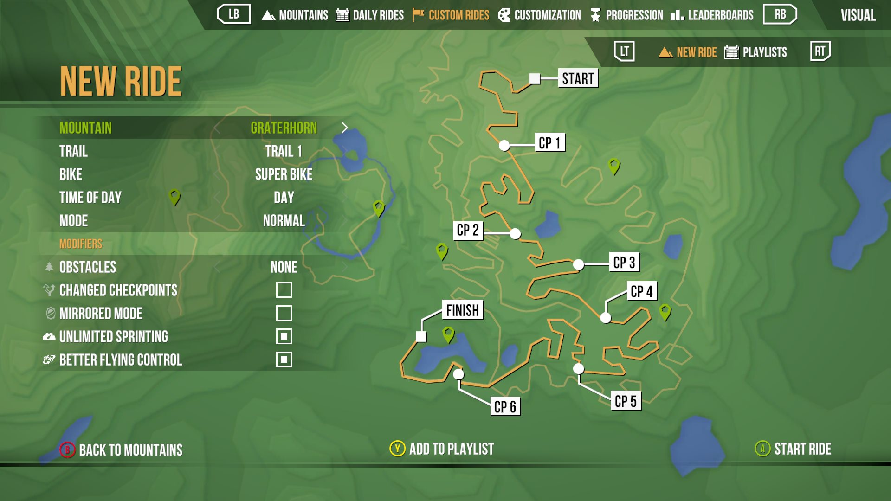
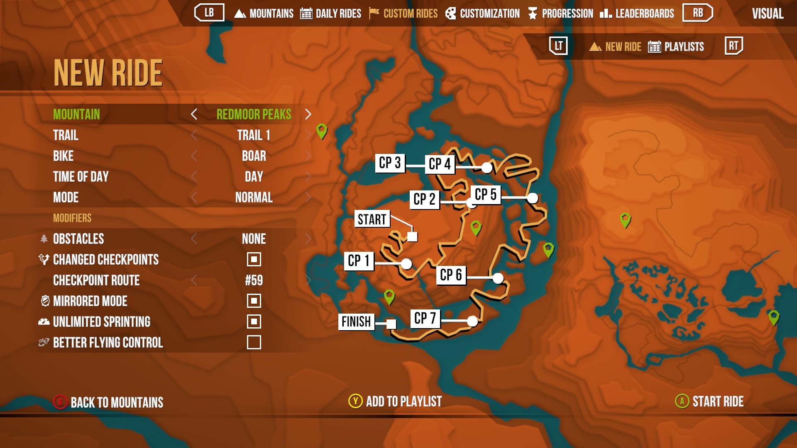
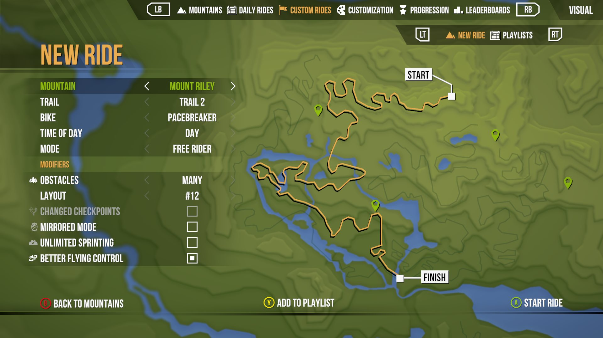
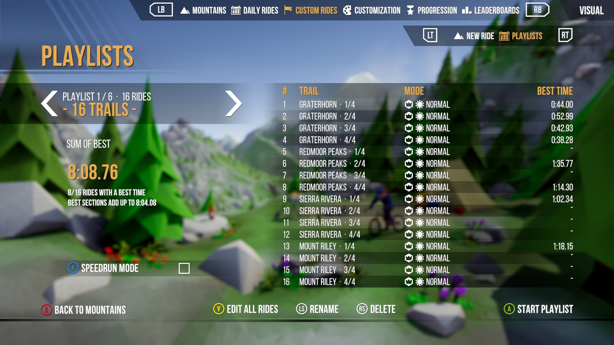
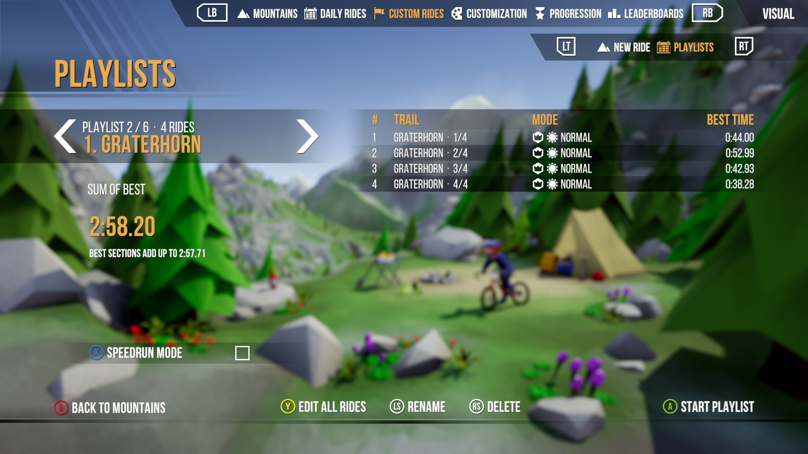
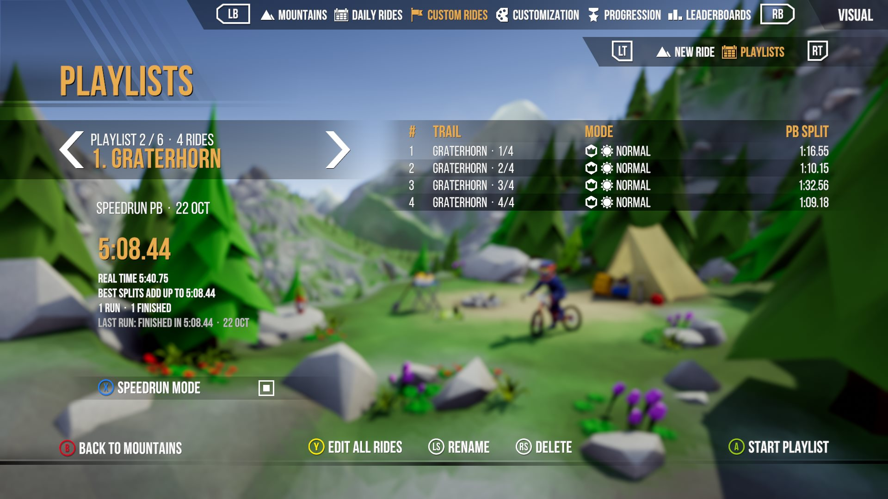

# LMD Custom Rides

Any trail, any Daily Rides modifier, and playlists to ride for best times or as one timed speedrun. A [MelonLoader](https://github.com/LavaGang/MelonLoader) mod for Lonely Mountains: Downhill.

**Custom Rides** is a new tab in the game menu, built from the game's own screens. It has two pages: **New Ride** to set up a ride, and **Playlists** to chain them. Switch between them with F / G (LT / RT on a gamepad).

Custom rides never reach the leaderboards, challenges or unlocks, and your Mountains tab stays as you left it. Keyboard, mouse and gamepad all work.

[New Ride](#new-ride) · [Playlists](#playlists) · [Install](#install) · [Times](#times) · [Ride codes](#ride-codes) · [Notes](#notes)

<br>

## New Ride


<table>
<tr>
<td width="33%"></td>
<td width="33%"></td>
<td width="33%"></td>
</tr>
</table>

Pick a trail, a bike (the Super Bike too), day or night, Normal or Free Rider, and any mix of the Daily Rides' modifiers. Press **Enter** to ride, or **T** to add the ride to a playlist.

Obstacle layouts and checkpoint routes are numbered from 1 to 999, and a number is the same ride on every PC. Hold Left or Right to run through them.

| Gamepad | Keyboard | |
|:---|:---|:---|
| A | Enter | Start the ride |
| X | Space | Flip a checkbox |
| Y | T | Add the ride to a playlist |

<br>

## Playlists


<table>
<tr>
<td width="33%"></td>
<td width="33%"></td>
<td width="33%"></td>
</tr>
</table>

Choose a playlist with Left / Right and press **Enter** to ride it. **Speedrun Mode** sets how:

- **Off:** ride by ride, with a result screen after each one to retry or go on. The page shows your **sum of best**: each ride's best time, added up.
- **On:** one timed run from trail to trail, crashes included. The page shows your **speedrun PB**, each ride's split in it, and your best splits from finished runs.

Six playlists come with the mod: all 16 trails, and one per mountain, on the Super Bike by day. Make your own with **+ New Playlist** (up to 48 rides). Ctrl+C copies a playlist to share it, Ctrl+V pastes one in.

| Gamepad | Keyboard | |
|:---|:---|:---|
| D-pad | Arrows | ← → choose a playlist, ↑ ↓ go through its rides |
| A | Enter | Ride the playlist, or the selected ride alone |
| X | C | Speedrun Mode on / off |
| Y | Space | Edit all rides, or the selected ride |
| LS | R / Z | Rename the playlist / move the selected ride |
| RS | T | Delete the playlist / remove the selected ride |

<br>

## Install

1. Open the game folder (Steam: right-click the game → Manage → Browse local files).
2. Download `MelonLoader.x64.zip` (0.7) from the [MelonLoader releases](https://github.com/LavaGang/MelonLoader/releases) and extract it into the game folder. Use the zip, not the installer: the installer can pick the wrong build for this game. Start the game once, then quit.
3. Extract the LMD Custom Rides zip from the releases page into the game folder.
4. Start the game: **Custom Rides** is in the top bar, next to Daily Rides.

<br>

## Times

- Every time is the game's own clock.
- A ride's best counts from any finish and follows the ride into every playlist.
- Under the clock you see your best for each section, then your difference once you pass it.
- Nothing ever deletes a time.

<br>

## Ride codes

Every ride is one line of text, in the Daily Rides' own format:

```
IS_01_A1/D/N/7/33979052/221790175527461/MB/MM/US/BAC
```

Ctrl+C on New Ride copies the ride, and Ctrl+V sets New Ride up from a code. Ctrl+C on the Daily Rides tab copies today's ride, so you can ride it again any day.

<br>

## Notes

- DLC trails need their DLC: Eldfjall Island, and the free fifth trails of each mountain.
- Your setup, playlists and times stay on your PC, in the game's `UserData` folder.
- Problems: the log is `MelonLoader\Latest.log`, this mod's lines start with `[LMD_Custom_Rides]`.

<br>

## Building

You need the game with MelonLoader (started once) and a .NET SDK 6 or newer. `.\build.ps1` builds the mod and puts the release zip in `dist\`. The UI is a small kit of the game's own components, described in [src/LMDCustomRides/Ui/Kit/README.md](src/LMDCustomRides/Ui/Kit/README.md).

<br>

## Credits

- **Megagon Industries** for the game.
- **LavaGang** for [MelonLoader](https://github.com/LavaGang/MelonLoader).

<br>

## License

MIT, see [LICENSE](LICENSE). Not affiliated with Megagon Industries.
